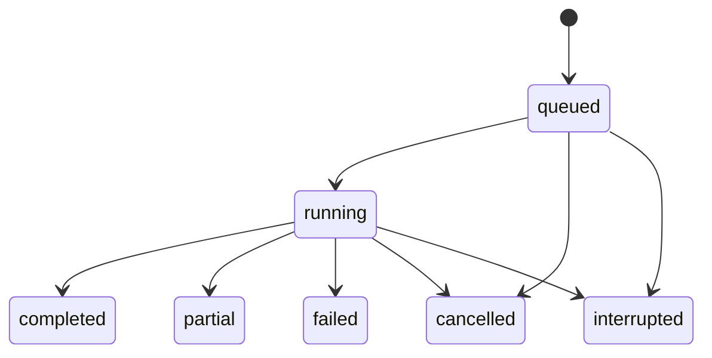

# HTTP API и модель данных

Это проект контрактов первой версии. Все маршруты ниже, кроме health и login, требуют `Authorization: Bearer <session_token>`. Сервер определяет пользователя по токену. JSON использует snake_case, идентификаторы — непрозрачные строки, время — UTC RFC 3339.

## HTTP маршруты

| Метод и путь | Запрос | Ответ |
| --- | --- | --- |
| `GET /healthz` | — | Жив ли процесс, без секретов |
| `GET /readyz` | — | Готовность БД, FTS5 и извлечения; зависимые API проверяются отдельным preflight |
| `POST /api/v1/auth/login` | login, password | session_token, expires_at, user |
| `POST /api/v1/auth/logout` | — | 204, отзыв текущей сессии |
| `GET /api/v1/me` | — | Текущий пользователь |
| `GET /api/v1/profile` | — | Интересы и предпочтения пользователя |
| `PUT /api/v1/profile` | interests, preferred_language | Обновлённый профиль |
| `GET /api/v1/conversations` | cursor, limit | Только собственные диалоги |
| `POST /api/v1/conversations` | title | Новый диалог |
| `GET /api/v1/conversations/{id}` | — | Диалог, сообщения и ссылки на run |
| `POST /api/v1/conversations/{id}/runs` | message, client_request_id | 202, run_id, status, progress_url |
| `GET /api/v1/runs/{id}` | — | Статус, прогресс, покрытие, usage и report_id |
| `GET /api/v1/runs/{id}/events` | after_seq, limit | События с возрастающим seq и next cursor |
| `POST /api/v1/runs/{id}/cancel` | — | Текущее состояние/подтверждение отмены |
| `GET /api/v1/reports/{id}` | — | Markdown отчёта, источники, покрытие и ограничения |
| `GET /api/v1/library` | cursor, limit | Работы, доступные текущему пользователю |
| `PATCH /api/v1/library/{paper_version_id}` | saved, read, note | Пользовательское состояние работы |
| `GET /api/v1/papers/{paper_version_id}` | — | Доступные метаданные, extraction/indexing status |
| `POST /api/v1/library/search` | query, необязательные paper_version_ids, limit | Гибридный поиск, режим и evidence IDs |
| `GET /api/v1/evidence/{id}` | — | Текст, источник, страница/раздел, URL оригинала |

Коллекции ограничены максимумом 100 элементов на страницу. Сервер ограничивает длины сообщений, профиля и заметок. Чужой ресурс возвращает тот же 404, что и отсутствующий. Доступ к evidence разрешён через библиотеку пользователя или принадлежащий ему run.

`client_request_id` уникален в пределах пользователя и диалога: повтор POST после сетевого обрыва возвращает прежний run. Повтор того же ID с другим сообщением возвращает 409. Пока в диалоге есть активный run, новый независимый запрос получает 409. Все POST запускаются после записи состояния; фоновая задача не зависит от времени HTTP-соединения.

## Пример результата retrieval

```json
{
  "retrieval_mode": "hybrid",
  "index_coverage": 1.0,
  "hits": [
    {
      "evidence_id": "ev_example",
      "paper_version_id": "pv_example",
      "text": "Example passage, not a real scientific claim.",
      "page": 4,
      "section": "Experiments",
      "lexical_rank": 3,
      "dense_rank": 1,
      "rrf_score": 0.032266
    }
  ]
}
```

Числа и IDs в примере демонстрационные. В обычном UI показываются источник и текст; технические ранги доступны в раскрываемых деталях результата и в артефакте приёмки.

## Модель хранения

| Таблица | Основные поля и связи |
| --- | --- |
| `users` | id, login unique, password_hash, created_at |
| `auth_sessions` | token_hash unique, user_id, expires_at, revoked_at |
| `profiles` | user_id unique, interests, preferred_language, updated_at |
| `conversations` | id, user_id, title, created_at |
| `runs` | id, user_id, conversation_id, client_request_id, status, cancel_requested, timestamps, budget, usage |
| `messages` | id, user_id, conversation_id, run_id, seq, role, content, reasoning_content, tool_calls_json, tool_call_id, provider_json |
| `run_events` | run_id, seq, event_type, public_payload_json, private_payload_json, created_at |
| `paper_versions` | id, arxiv_id, version, title, authors_json, abstract, canonical URLs, source timestamps |
| `documents` | id, paper_version_id, format, content_hash, extractor_version, extraction_status, warnings_json, local_path |
| `chunks` | id/evidence_id, document_id, ordinal, text, char_start, char_end, page_start/end, section |
| `chunks_fts` | FTS5 projection по chunk ID, title, section, text |
| `chunk_embeddings` | chunk_id, model_id, model_digest, encoding_version, dimensions, input_hash, vector_blob |
| `document_indexes` | document_id, embedding identity, indexed/total chunks, status, last_error |
| `user_papers` | user_id, paper_version_id, saved, read, note, added_at; составной unique |
| `run_sources` | run_id, paper_version_id, selection_reason, analysis_status |
| `analysis_segments` | run_id, document_id, start/end, input_hash, analysis_json, evidence_ids, status, usage |
| `reports` | id, user_id, run_id, markdown, citations_json, coverage_json, limitations_json |

`paper_versions` и публичные documents/chunks могут переиспользоваться техническим кэшем. Все пользовательские данные имеют прямого владельца или проверяемую цепочку владения. Membership в `user_papers` создаётся при импорте в исследование; `saved` отдельно обозначает явное сохранение в библиотеке. Составные ограничения не позволяют привязать run к чужому диалогу.

Provider messages сохраняются для воспроизводимости запроса, но API не отдаёт `reasoning_content`, приватные payloads и provider headers. В публичных событиях нет ключей, токенов или паролей. Исходный bearer-token хранится у клиента только на время сессии; сервер сохраняет его криптографический хеш. Два пользователя создаются идемпотентной seed-командой с хешами паролей, без автоматического сброса уже существующих аккаунтов.

## Состояния



Terminal states: `completed`, `partial`, `failed`, `cancelled`, `interrupted`. Отмена уже завершённого run не меняет его результат. Успешный run может содержать часть источников `abstract_only`, если есть достаточный результат и ограничения явно указаны; приёмка отдельно требует хотя бы одну полностью разобранную статью.

Три независимые оси документа: `extraction_status=full_text|abstract_only|failed`, `index_status=pending|ready|partial|failed`, `analysis_status=none|partial|complete|abstract_only`. Даже `full_text` не обещает извлечения изображения; предупреждения и координаты сохраняются отдельно.

## Ошибки и прогресс

Общий JSON ошибок: `error.code`, `error.message`, `error.retryable`, `request_id`. Базовые HTTP статусы: 400 — неверный ввод; 401 — нет сессии; 404 — нет доступного ресурса; 409 — конфликт активного запуска или idempotency; 429 — заполнен локальный пул; 503 — зависимость недоступна.

События run: `run_started`, `search_started`, `papers_found`, `document_loaded`, `document_extracted`, `index_progress`, `analysis_progress`, `retrieval_completed`, `tool_failed`, `report_saved`, `run_finished`. Событие `retrieval_completed` содержит фактический режим и обе ветки; `analysis_progress` показывает покрытые части, а не выдуманный процент готовности модели.

Пользовательские ошибки различают: `source_unavailable`, `text_unusable`, `embedding_unavailable`, `embedding_incompatible`, `provider_rate_limited`, `context_limit`, `budget_exceeded`, `run_interrupted`. Технические подробности находятся в локальных логах с run ID, без секретов.

## Реализованный research API T12

HTTP admission запускает AgentRunner в фоне; polling, атомарное сохранение
отчёта/terminal status, owner-scoped отчёты, метаданные и библиотека реализованы.
Точные поля coverage, семантика снимков и повторяемые проверки:
[research-api.md](research-api.md). Фактические результаты:
[verification/T12.md](verification/T12.md).

## Память исследований — контракт продолжения

В T19 добавляются authenticated POST /api/v1/research-memory/search и GET/PATCH /api/v1/research-memory/{memory_id}; PATCH выполняет explicit correction или exclusion с expected_revision, owner берётся только из auth. T20 добавляет memory_recalled и optional research_memory в existing Report: retrieval_mode, reasons, recalled, referenced. Точные JSON и происхождение источников — [research-memory.md](research-memory.md). Memory содержит atomic claim cards с facet/evidence/analysis и версионированные user corrections/exclusions. Из reports/analyses восстанавливается базовая память; rebuild сохраняет пользовательские поправки. Отдельная исходная сущность отчёта не создаётся.
