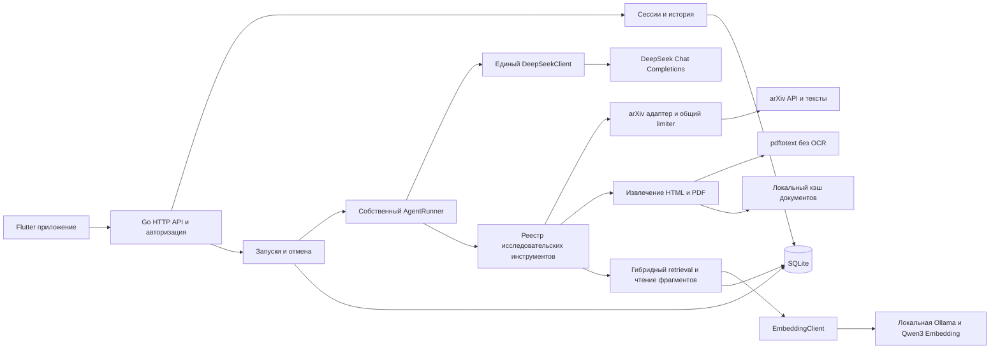

# Архитектура Paper Scout

## Состав системы

Один Go-процесс обслуживает API, запускает исследования в ограниченном пуле, обращается к DeepSeek, arXiv и локальной Ollama, сохраняет состояние в SQLite и исходные документы в локальном каталоге. Ollama выполняет embedding-модель. Flutter не выполняет агентные действия и не получает ключ DeepSeek.



## Границы модулей

| Модуль | Ответственность |
| --- | --- |
| `httpapi` | JSON-контракты, проверка входа, middleware авторизации, получение прогресса |
| `auth` | Два аккаунта, хеши паролей, выдача и отзыв сессий |
| `store` | SQL, миграции, ownership, транзакции и FTS5 |
| `research` | Создание запусков, планировщик локального пула, отчёты, покрытие анализа |
| `agent` | Состояние сессии, построение контекста, цикл, реестр tools, бюджеты |
| `deepseek` | Единственная реализация HTTP-контракта Chat Completions |
| `arxiv` | Поиск, метаданные, разрешённые ссылки, кэш и ограничения запросов |
| `documents` | Загрузка, извлечение, разбиение, привязка к страницам/разделам |
| `retrieval` | Пользовательский поиск по сохранённым фрагментам и возврат доказательств |
| `embeddings` | HTTP-клиент Ollama, query/document encoding и проверка совместимости векторов |

Это внутренние пакеты одного приложения, а не отдельные сервисы. MCP после исключения дня 33 в архитектуру не включён. Если позже появится внешняя интеграция, она подключается к реестру tools отдельным адаптером.

## Путь исследовательского запроса

1. API определяет пользователя из сессии, проверяет принадлежность диалога и сохраняет запрос с запуском в одной транзакции.
2. Фоновая задача получает самостоятельный `context.Context`, связанный с жизненным циклом сервера и отменой запуска. Завершение короткого HTTP-запроса не отменяет исследование.
3. AgentRunner собирает профиль, допустимую историю и описания tools, вызывает DeepSeek и выполняет выбранные инструменты.
4. Каждый шаг и результат сохраняются до перехода к следующему. Flutter опрашивает состояние и события раз в секунду, реже при уходе в фон.
5. Анализ доступных текстов и синтез отчёта используют тот же DeepSeekClient. Все такие вызовы входят в бюджет запуска.
6. Завершённый ответ, ссылки и покрытие фиксируются транзакционно. UI показывает отчёт и позволяет открыть доказательные фрагменты.

## Получение и чтение полного текста

Поиск возвращает метаданные, а не готовое содержимое статьи. У каждой версии работы отдельные идентификатор источника, URL, хеш полученного документа, статус извлечения и версия извлекателя.

Последовательность: получить доступный HTML arXiv → проверить, что это текст статьи → извлечь основной текст с разделами. Если HTML недоступен или непригоден, загрузить PDF → проверить тип и размер → получить число страниц → запустить `pdftotext` с UTF-8 и сохранением page breaks. HTML доступен не для всех работ, поэтому он не является единственным путём. [Официальное описание HTML arXiv](https://info.arxiv.org/about/accessible_HTML.html).

Артефакты извлечения: весь текст, упорядоченные chunks, номера страниц PDF либо заголовки разделов HTML, стабильные локальные evidence IDs. Для PDF непустой текст нескольких страниц не доказывает успешное извлечение всех страниц: страницы без текста учитываются как предупреждения, особенно внутри основного содержания. Изображения и сложные формулы могут остаться вне извлечённого текста.

Анализ имеет два пути:

- Если полный извлечённый текст помещается в разрешённый контекст, передать его целиком и сохранить покрытый диапазон.
- Иначе пройти **все** части по порядку, сохранить структурированные наблюдения с evidence IDs, затем синтезировать результат из этих наблюдений. Части не пропускаются по оценке тематической релевантности.

Карта покрытия хранит переданные диапазоны и успешность анализа. Только их объединение, покрывающее весь извлечённый текст, даёт `complete`. Прерывание, лимит или ошибка части дают `partial`; отдельные найденные через RAG абзацы сами по себе не дают `complete`.

Если извлечение требует OCR или полный текст не получен, источник сохраняется с причиной и аннотацией. Такой материал может участвовать в подборке, но отмечается `abstract_only`; детали эксперимента из него не достраиваются.

## Retrieval и научная библиотека

Каждый chunk индексируется в FTS5 и получает embedding. Запрос идёт в две ветки: BM25 по точным терминам и cosine similarity по вектору вопроса. Ранжированные списки объединяются через RRF, после чего убираются перекрывающиеся фрагменты и формируется ограниченный контекст с координатами источников. Пользовательский фильтр применяется в обеих ветках до выбора кандидатов.

Эмбеддинги получает отдельный EmbeddingClient через уже установленную Ollama с `qwen3-embedding:0.6b`. Векторы сохраняются в SQLite; для небольшой библиотеки exact cosine search выполняется в Go. DeepSeekClient обслуживает только генерацию и tool calling. Детали модели, версионирования, RRF и деградации описаны в [гибридном RAG](hybrid-rag.md).

Первичный полный разбор проходит по всему тексту. Retrieval используется для уточняющих вопросов, повторной проверки утверждений и работы с ранее сохранённой библиотекой. Получение нескольких релевантных chunks не считается полным чтением статьи.

Для отчёта сервер проверяет существование указанных evidence IDs и доступ пользователя к ним. Такая проверка подтверждает адресуемость источника; смысловое соответствие утверждения источнику проверяется при реальной приёмке. Нельзя обозначать формальную проверку ссылок как автоматическую проверку научной достоверности.

## Изоляция и хранение

Профили, диалоги, запуски, сообщения, заметки, отчёты и членство в библиотеке принадлежат пользователю. Все операции получают `userID` из серверного auth context; модель и клиент не могут назначить владельца аргументом инструмента.

Общими могут быть только публичные метаданные и технический кэш конкретной версии статьи. Доступ к содержимому через API и retrieval проверяется по пользовательской библиотеке или выбранным источникам его запуска. Отчёты и заметки в общий кэш не попадают. Пользовательский фильтр применяется в SQL до ограничения числа результатов.

SQLite работает с foreign keys, WAL, busy timeout и короткими транзакциями. Сетевые вызовы и анализ PDF выполняются вне транзакций. В первой версии один writer connection упрощает запись; чтение не держит длительных блокировок. Документы записываются атомарно по генерируемым сервером именам. Конкретные PRAGMA проверяются с выбранной версией драйвера.

## Сбои и восстановление

- Перезапуск сервера переводит незавершённые запуски в `interrupted`. Готовые результаты и история остаются доступны; автоматический повтор платных вызовов не выполняется.
- Ошибки одного источника не теряют уже полученные источники. Отчёт с частичным результатом имеет статус `partial` и объяснение.
- Отмена останавливает будущие действия и передаётся HTTP-клиентам и дочернему `pdftotext`.
- Для временных ошибок сети и 429 допускается ограниченный повтор с задержкой; попытки учитываются в бюджете, а неизвестная стоимость прерванного запроса не представляется нулевой.
- arXiv использует общий последовательный limiter и кэш. Между запросами не менее трёх секунд; одинаковые поисковые запросы кэшируются на сутки. [Условия API](https://info.arxiv.org/help/api/tou.html), [руководство API](https://info.arxiv.org/help/api/user-manual.html).

## Минимальные границы исполнения

Сервер загружает только источники arXiv по проверенному идентификатору и разрешённым адресам; redirects проверяются повторно. Локальные, приватные и произвольные пользовательские URL не поддерживаются. PDF ограничен размером и временем обработки; исполняется фиксированная команда с массивом аргументов, без shell. Текст статьи — данные для анализа, а не инструкции менять профиль или выполнять другие действия.

## Будущая структура репозитория

```text
cmd/paper-scout/       Go entrypoint
internal/httpapi/     HTTP и middleware
internal/auth/        аккаунты и сессии
internal/store/       SQLite и миграции
internal/research/    запуски, анализ, отчёты
internal/agent/       собственный harness
internal/deepseek/    единый Chat Completions client
internal/arxiv/       каталог и загрузка источников
internal/documents/  HTML/PDF, chunks, координаты
internal/retrieval/  поиск доказательных фрагментов
internal/embeddings/ Ollama embedding client
client/              Flutter-приложение
integration/         интеграционные проверки, без unit tests
scripts/             локальный запуск и запись
docs/                проектная документация
data/                локальные данные, исключены из Git
artifacts/           результаты приёмки и видео, исключены из Git
```

## Память между исследованиями — продолжение T19–T22

Память имеет три уровня: эпизоды исходных исследований, атомарные записи methods/results/limitations с evidence из существующего Analysis и явные пользовательские notes/corrections, рабочий контекст нового run. internal/researchmemory выполняет bounded capture/consolidation (ADD/NOOP, явные revisions/exclusions) и hybrid recall (SQLite FTS5, существующий EmbeddingClient, RRF). Исходные отчёты/analyses не переписываются. AgentRunner перед первым запросом модели автоматически получает релевантные прошлые исследования вне текущего диалога. Снимок recall и проверенные ссылки сохраняются на run/report; UI отличает найденное от реально процитированного. Обязательна wiring в cmd/paper-scout. Полные границы, конкурентные обновления и критерии — [research-memory.md](research-memory.md).
