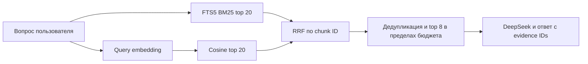

# Гибридный RAG Paper Scout

## Выбор модели и границы

Для генерации и управления агентом используется DeepSeek Chat Completions. Для dense retrieval используется **отдельный EmbeddingClient** к локальной Ollama, модель `qwen3-embedding:0.6b`. На ноутбуке уже обнаружены работающая Ollama и эта модель; реальная генерация embeddings и качество поиска должны быть проверены при реализации.

Модель поддерживает многоязычный retrieval и размерность до 1024. Для первой версии фиксируется полный 1024-мерный вектор; уменьшение размерности не включено. [Карточка модели Qwen](https://huggingface.co/Qwen/Qwen3-Embedding-0.6B), [модель в Ollama](https://ollama.com/library/qwen3-embedding).

Используем `POST /api/embed` с пакетами текстов. `truncate=false`: превышение контекста должно стать ошибкой и привести к разбиению входа, а не скрытому усечению. [API Ollama](https://docs.ollama.com/api/embed).

## Индексация

1. Сохранить версию исходного документа и полный извлечённый текст с координатами.
2. Разбить по разделам и абзацам, сохраняя страницы PDF. Начальные ориентиры — 2000 символов на chunk, перекрытие около 250 символов; это конфигурация, а не утверждение о точном числе токенов.
3. Для документа кодировать заголовок статьи, название раздела и текст chunk. Не добавлять пользовательские заметки в общий публичный embedding-кэш.
4. Отправить batch в Ollama, проверить число векторов, размерность, конечность значений и ненулевую норму; нормализовать L2.
5. Сохранить float32-векторы вместе с model digest, размерностью, версией encoding/chunking и хешем текста. FTS5 и embedding одного chunk ссылаются на одну версию документа.
6. Документ получает `index_ready` только после завершения обеих веток. Прогресс индексирования хранится отдельно от полноты чтения моделью.

Векторный кэш ключуется моделью, её digest, режимом encoding и хешем точного входа. Смена модели, версии шаблона, размерности или chunking требует новой индексации. Векторы разных пространств не сравниваются, даже если у них совпадает длина.

## Обработка запроса

Сохраняются исходный вопрос и сформированные агентом английские поисковые термины. Для embedding вопроса применяется query instruction модели: `Instruct: Retrieve scientific passages relevant to the research question.\nQuery: ...`; для документов query instruction не добавляется. Фактическое поведение Ollama-шаблона проверяется, чтобы instruction не добавлялась дважды. Правило query/document encoding следует [примеру авторов модели](https://github.com/QwenLM/Qwen3-Embedding).



Обе ветки работают только с разрешёнными источниками текущего пользователя или его запуска. FTS5 получает безопасно построенный MATCH-запрос с параметризованным SQL; свободная строка пользователя не становится SQL или неограниченным выражением FTS. Dense search сначала получает разрешённые векторы из SQLite, затем вычисляет top-k в Go.

Для первой небольшой библиотеки достаточно точного поиска по нормализованным векторам: скалярное произведение равно cosine similarity. Сложность — O(N × d), где N — число разрешённых chunks, d = 1024. Устанавливается лимит, например 20 тысяч chunks на поисковый scope; превышение требует сужения scope или перехода на специализированный индекс, а не молчаливого поиска по случайной части библиотеки. Отдельный Qdrant/pgvector для прототипа не нужен.

## Объединение результатов

Используется Reciprocal Rank Fusion:

```text
score(chunk) = sum(1 / (60 + rank_in_branch))
```

Ранги начинаются с единицы. Если chunk отсутствует в ветке, её вклад равен нулю. Берём объединение top-20 каждой ветки, складываем вклады, сортируем по убыванию с устойчивым tie-break по chunk ID. BM25 и cosine scores напрямую не складываются: их шкалы различаются. [Описание RRF](https://learn.microsoft.com/en-us/azure/search/hybrid-search-ranking).

После fusion объединяются или удаляются сильно перекрывающиеся chunks одной статьи, при необходимости читаются соседние абзацы. В контекст попадают до восьми фрагментов в пределах текстового бюджета, с заголовком, страницей/разделом и evidence ID. Отдельная reranker-модель в первой версии не обязательна; её добавление требует измеримого выигрыша на проверочных запросах.

## Деградация

Если Ollama недоступна, embedding некорректен или часть источников ещё не индексирована, API сообщает `retrieval_mode=lexical_only` либо `hybrid_partial`, причину и покрытие индекса. Лексический результат допустим как явно обозначенный временный режим, но **не проходит приёмку гибридного RAG**. По умолчанию новый запрос не выдает деградацию за обычный успешный гибридный поиск.

Недоступность источника и недоступность embeddings — разные причины: `abstract_only` описывает глубину материала; `lexical_only` — способ поиска. Они не заменяют друг друга.

## Проверка без юнит-тестов

Через работающие API, SQLite и embedding backend проверяются: точный термин, научная перефразировка, русский вопрос по английскому тексту, нерелевантный запрос, раздельные библиотеки пользователей, недоступная Ollama, несовместимая версия вектора и повторное использование кэша. В live-проверке сохраняются ранги BM25/dense/RRF и evidence IDs для нескольких заранее размеченных вопросов.

Критерий — обе ветки действительно выполняются, релевантный размеченный фрагмент попадает в итоговый top-8, а ответ ссылается на него. Нельзя обещать, что fusion всегда превзойдёт каждую отдельную ветку на каждом вопросе. Целевые вопросы и результаты записываются в артефакт приёмки, включая неудачные случаи.
