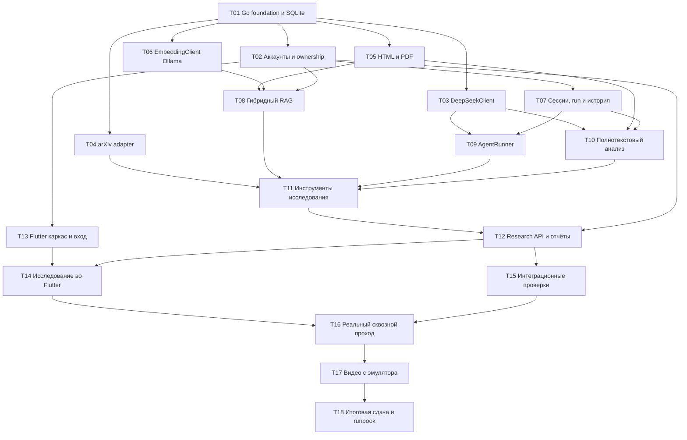

# DAG реализации Paper Scout

Цель DAG — получить реальный вертикальный проход как можно раньше, затем закрыть сохранение, изоляцию и доказательства дня 35. Сначала выполняется зависимость, затем задача; независимые ветви можно вести параллельно, но этот план сам по себе не запускает дополнительных агентов.

Машиночитаемые зависимости и итоговые статусы находятся в [implementation-tasks.json](implementation-tasks.json), сведения о слияниях — в [execution-state.json](execution-state.json). Схема и таблица ниже описывают тот же граф. Порядок работы трёх ролей на каждую ноду определён [протоколом выполнения](execution-protocol.md).

## Граф зависимостей

## Задачи и критерии выхода

| ID | Задача | Зависит от | Проверяемый результат |
| --- | --- | --- | --- |
| T01 | Создать Go entrypoint, config, миграции и SQLite | — | `/healthz`, `/readyz`, повторный старт с той же БД; FTS5 доступна через выбранный Go driver; зависимости совместимы с локальным Go |
| T02 | Два аккаунта, auth sessions и ownership | T01 | Вход/выход, идемпотентный seed; чужой ресурс недоступен |
| T03 | Единый DeepSeekClient | T01 | Один реальный Chat Completions request; tool-enabled обмен, usage и обработка ошибок; ключ только на сервере |
| T04 | Поиск arXiv, версии, limiter и кэш | T01 | Реальные Atom metadata, нормализованные IDs, повтор без дублирования источника |
| T05 | Полный текст HTML/PDF и chunks | T01 | Один реальный текстовый PDF извлечён с page boundaries; HTML имеет sections; пустой текст не помечен полным |
| T06 | EmbeddingClient к существующей Ollama | T01 | Реальный batch/query encoding, 1024 finite values, проверка модели/digest, без скрытого truncation |
| T07 | Диалоги, run, история, события и отмена | T02 | Состояние переживает рестарт; один активный run на диалог; idempotency; interrupted после обрыва |
| T08 | Индексация и гибридный retrieval | T02, T05, T06 | BM25 + cosine + RRF, обе ветки с ownership, evidence IDs, явная деградация |
| T09 | Собственный AgentRunner и реестр tools | T03, T07 | Цикл Chat Completions → tool → Chat Completions; coherent history, ошибки, отмена и пределы |
| T10 | Анализ всего текста и coverage | T03, T05, T07 | Все диапазоны подходящей статьи обработаны; ошибки и лимиты дают partial; ссылки ведут в исходник |
| T11 | Подключить исследовательские tools | T04, T08, T09, T10 | Через AgentRunner выполняется реальный поиск, импорт, анализ и follow-up retrieval |
| T12 | Собрать research API и сохранение отчётов | T02, T11 | HTTP-запрос создаёт run, polling показывает ход, отчёт/источники доступны после рестарта |
| T13 | Flutter каркас, API-клиент и вход | T02 | Приложение стартует на эмуляторе, вход проверен через `claude-in-mobile`, два аккаунта, корректная обработка 401; базовый URL настраивается |
| T14 | Диалоги, прогресс, отчёт и библиотека | T12, T13 | Пользователь выполняет исследование, открывает evidence, задаёт follow-up и сохраняет заметку |
| T15 | Интеграционные проверки | T12 | HTTP + SQLite + реестры/адаптеры: ownership, полные тексты, RRF, лимиты, отмена, сохранение; unit tests отсутствуют |
| T16 | Реальный проход через Flutter | T14, T15 | Управление через `claude-in-mobile`; DeepSeek + arXiv + Ollama, одна полностью прочитанная работа, hybrid follow-up, два аккаунта и рестарт |
| T17 | Записать и проверить видео | T16 | MP4 с эмулятора воспроизводится и показывает обязательные условия |
| T18 | Собрать итоговую сдачу | T17 | README с фактическим запуском, результаты проверок, ссылка на видео, краткое описание задачи дня 35 |

## Ранние контрольные точки

**Проверка внешних зависимостей:** T03, T04, T05, T06. До полной сборки UI известно, что работают реальная модель, каталог, извлечение и embeddings. При выявленной проблеме не продолжаем разработку на фиктивном успешном результате.

**Первый работающий исследователь через API:** T12. Этот рубеж объединяет оба пути — полный текст и гибридный retrieval. Можно отдельно запускать интеграционные проверки API до завершения UI.

**Первый рабочий продукт:** T14. Все обязательные действия доступны из Flutter; T15 и T16 закрывают корректность и реальные зависимости.

**День 35 выполнен:** T18. Видео — самостоятельная зависимая задача после работающего сценария, а не обещание записать позже.

## Пример допустимого топологического порядка

T01 → T03 → T04 → T05 → T06 → T02 → T07 → T08 → T09 → T10 → T11 → T12 → T13 → T14 → T15 → T16 → T17 → T18.

Точный критический путь по времени нельзя вычислить без оценок длительности. Архитектурные ветви сходятся в T11 и T12; весь путь сдачи обязательно проходит через T16–T18. Календарные сроки и фиктивные проценты готовности не назначаются.

## Правила выполнения

1. На каждом шаге делать минимальный работающий результат и только нужную для него проверку.
2. Не писать юнит-тесты; не оставлять автоматически созданные шаблонные unit/widget tests.
3. Для интеграционных проверок допустим HTTP fixture server на границе внешнего провайдера, но он не заменяет live-проверку.
4. Не добавлять расписания, MCP, поддержку, регистрацию или отдельную векторную БД в критический путь.
5. Внешний временный сбой записывать отдельно от ошибки приложения. Моки, cache hit и live network call явно различать в артефактах.
6. После готовности конкретной функции обновлять её статус и фактические команды запуска, а не обозначать весь проект завершённым.

## Продолжение: память между исследованиями

Предыдущие T01–T18 выполнены. Новый пользовательский результат и фиксированные
контракты: [research-memory.md](research-memory.md). Не обозначать его готовым
по прежним артефактам. Зависимости: `T18 → T19 → {T20, T21} → T22`.

| ID | Задача | Зависит от | Проверяемый результат |
| --- | --- | --- | --- |
| T19 | Owner-scoped write/consolidation памяти, hybrid recall и HTTP | T18 | Эпизоды reports + atomic method/result/limitation cards из existing Analysis + versioned notes/corrections/exclusions; bounded ADD/NOOP/write/read; настоящий BM25+Qwen3+RRF; backfill без DeepSeek сохраняет пользовательские поправки; актуализация/удаление notes без stale публикации; 404/изоляция обеих веток; Go/JSON-контракты для T20/T21 зафиксированы в research-memory.md. AgentRunner и Flutter не меняет |
| T20 | Автоматический recall и доказуемое сравнение в агенте | T19 | Capture после report commit с восстановлением пропущенного capture без платного replay; перед первым model request recall по вопросу вне диалога; снимки/referenced IDs, provenance, личная note отделена от фактов; validated memory links; existing Report research_memory и event; production cmd/paper-scout wiring, bounded бюджеты; новые инструменты не заменяют automatic recall. Интеграции без unit tests |
| T21 | Flutter: найденная память и переход к прошлому исследованию | T19 | Optional research_memory разбирается по контракту; recalled отличается от referenced, открывается прежний отчёт/статья/заметка без потери выбранного run, note объяснена как будущий контекст, explicit correction/exclude/restore и revision работают, 401 очищает память. Реальный UI через claude-in-mobile, fixtures подписаны. Работает параллельно T20, не меняет Go-agent |
| T22 | Production live приёмка A→заметка→рестарт→новый диалог B, видео и сдача | T20, T21 | Обычный cmd/paper-scout + Flutter + реальные DeepSeek/arXiv/Ollama; A не названа в новом вопросе, B другая работа; заметка учтена, ссылки A/B проверены, три утверждения сверены; write/NOOP/исправление/exclusion не сбрасываются рестартом/backfill; note edit/clear и аккаунт B; отдельное видео research-memory-demo.mp4; README/runbook/evidence обновлены. Критерии research-memory.md обязательны |

Каждая нода сохраняет два review/fix, отдельное упрощение, итоговый контроль и
serialized merge. До завершения T22 новая продуктовая приёмка не закрыта.
